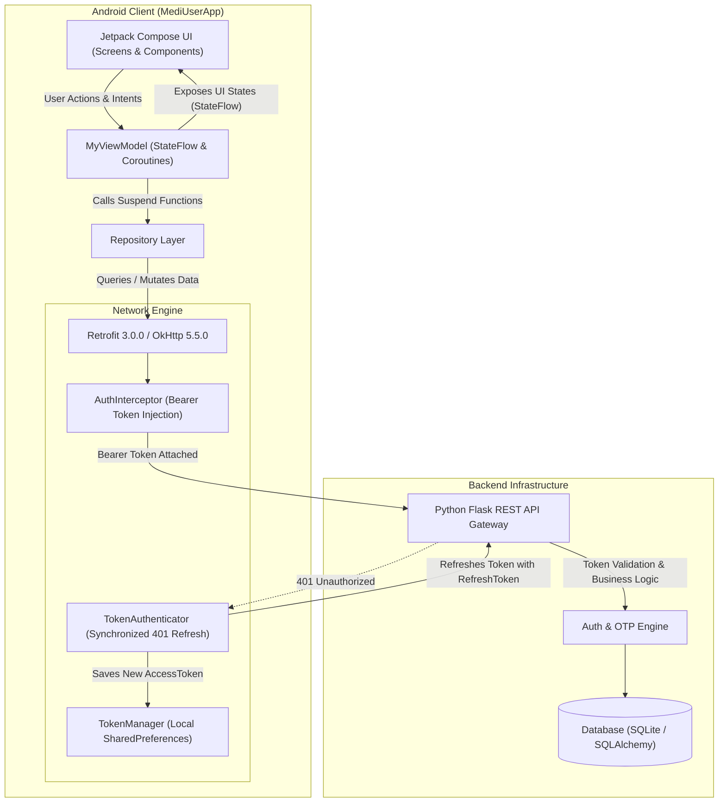
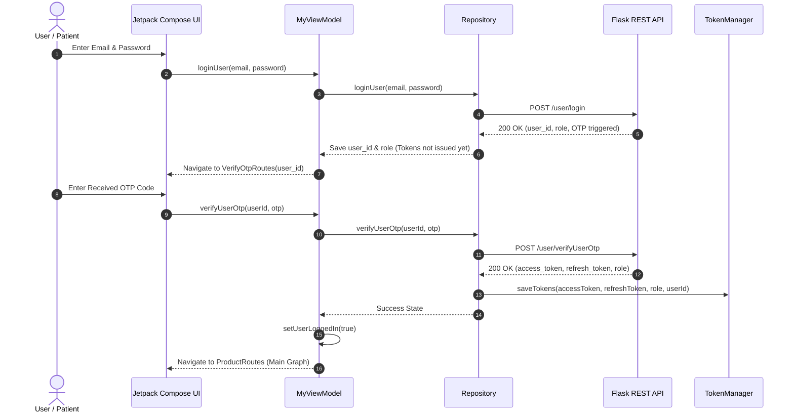
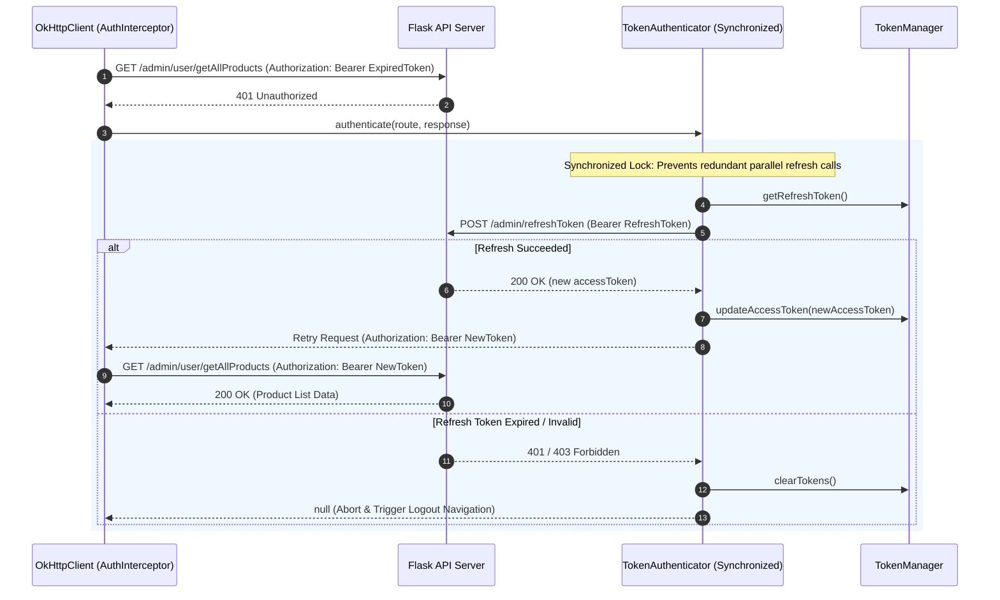

# 💊 MediUserApp — Smart Healthcare & Medicine Management Client

<p align="center">
  
  
  
  
  
  
  
  
  
</p>

<p align="center">
  <strong>Next-Generation Android Medicine Ordering and Pharmacy Management Client</strong><br />
  Engineered with <em>Jetpack Compose</em>, <em>Clean Architecture</em>, <em>Dagger Hilt</em>, and a <em>Dual-Token JWT + OTP Self-Healing Security Pipeline</em>.
</p>

---

> [!IMPORTANT]
> **MediUserApp** is the official native Android client designed to communicate with the **Medi Management Flask REST API**. It delivers an enterprise-grade medical shopping experience with two-factor OTP verification, resilient token rotation, live product cataloging, and comprehensive purchase history tracking.

---

## 📌 About The Project

In the modern healthcare and pharmaceutical ecosystem, secure access to medicine, transparent inventory tracking, and bulletproof user authentication are mission-critical. Traditional mobile commerce applications often struggle with session dropouts, insecure token persistence, and sluggish state synchronizations.

**MediUserApp** solves these challenges by combining:
1. **Zero-Trust Authentication:** Password authentication reinforced by email/SMS One-Time Passwords (OTP) and dual-token JWT rotation (short-lived Access Tokens + long-lived Refresh Tokens).
2. **Self-Healing Session Recovery:** OkHttp interceptor suite that detects expired access tokens (`HTTP 401 Unauthorized`), triggers thread-synchronized token refreshes in the background, and replays failed requests without user disruption.
3. **Declarative Reactive UI:** Pure Jetpack Compose with Material 3 design, powered by Kotlin Coroutines, StateFlow, and Unidirectional Data Flow (UDF).
4. **Resilient Offline-Ready Architecture:** Clean separation of concerns with Repository pattern and Dagger Hilt dependency injection.

---

## ✨ Key Features

- 🔐 **Dual-Factor Authentication (JWT + OTP):**
  - Secure registration and login flows requiring verification codes sent directly to the user.
  - Multi-tier JWT token exchange ensuring credentials never linger in transmission.
- 🔄 **Self-Healing Token Refresh (401 Interception):**
  - Custom `AuthInterceptor` injects Bearer credentials dynamically for private endpoints.
  - Custom `TokenAuthenticator` intercepts `401 Unauthorized` responses and synchronizes background refresh token calls to prevent race conditions.
- 📦 **Live Pharmaceutical Catalog & Search:**
  - Fast, responsive browsing of medicines with categorized catalog lists, unit pricing, real-time stock levels, and instant search filtering.
- 🛒 **Instant Order Processing & Tracking:**
  - One-tap order placement with custom delivery instructions and real-time total computation.
  - Transparent order lifecycle tracking (`Pending`, `Approved`, `Sold / Dispatched`).
- 📊 **Audit & Sales History:**
  - Comprehensive view of historical medicine acquisitions with order IDs, timestamps, quantities, and itemized billing.
- 🔑 **Robust Password Recovery:**
  - End-to-end 3-step forgot-password workflow: Request OTP $\rightarrow$ Verify OTP $\rightarrow$ Reset Password securely without session hijacking.
- 👤 **Profile & Secure Credential Management:**
  - Fast user details lookup with stored delivery addresses and pincodes.
  - One-tap secure logout that purges local tokens and resets application navigation graphs.

---

## 🏗️ Architecture & Workflow

MediUserApp strictly adopts **Clean Architecture** and the **MVVM (Model-View-ViewModel)** design pattern with **Unidirectional Data Flow (UDF)**.

### 1. High-Level System Architecture



---

### 2. User Authentication & Token Acquisition Flow



---

### 3. Automatic 401 Token Refresh Sequence



---

## 🛠️ Tech Stack & Dependencies

### Mobile Application (Android)
| Layer / Tool | Technology | Version | Description |
| :--- | :--- | :--- | :--- |
| **Language** | [Kotlin](https://kotlinlang.org/) | `2.4.0` | 100% Modern Kotlin with Coroutines & Flow |
| **UI Toolkit** | [Jetpack Compose](https://developer.android.com/jetpack/compose) | `BOM 2026.09.00` | Declarative UI framework with Material 3 |
| **Dependency Injection**| [Dagger Hilt](https://dagger.dev/hilt/) | `2.60.1` | Modular dependency injection via KSP |
| **Networking** | [Retrofit](https://square.github.io/retrofit/) | `3.0.0` | Type-safe REST client for Android & Kotlin |
| **HTTP Client** | [OkHttp](https://square.github.io/okhttp/) | `5.5.0` | HTTP stack with interceptors and connection pooling |
| **JSON Serialization** | [Gson](https://github.com/google/gson) / [Kotlinx Serialization](https://github.com/Kotlin/kotlinx.serialization) | `3.0.0` / `1.11.0` | High-performance JSON mapping & Type-Safe routing |
| **Navigation** | [Navigation Compose](https://developer.android.com/jetpack/compose/navigation) | `2.9.8` | Type-safe declarative destination navigation |
| **Image Loading** | [Coil Compose](https://coil-kt.github.io/coil/) | `2.7.0` | Asynchronous image loading for Compose |
| **Charts & Visuals** | [MPAndroidChart](https://github.com/PhilJay/MPAndroidChart) | `v3.1.0` | Sales history graphing and analytics |
| **Image Cropping** | [uCrop](https://github.com/Yalantis/uCrop) | `2.2.8` | Image cropping utility for profile pictures |
| **Environment** | [dotenv-kotlin](https://github.com/cdimascio/dotenv-kotlin) | `6.5.1` | Local environment variable management |

### Backend API (Integration Target)
- **Framework:** Python Flask (REST API)
- **ORM / Database:** SQLAlchemy, SQLite / PostgreSQL
- **Data Validation:** Marshmallow Schemas
- **Security:** Passlib (Bcrypt), PyJWT (Access + Refresh Token), Cryptographic OTP Generator

---

## 📁 Project Directory Structure

```text
MediUserApp/
├── app/
│   ├── build.gradle.kts                   # App-level dependencies, plugins & build config
│   └── src/
│       ├── androidTest/                   # Espresso & Compose UI instrumentation tests
│       ├── test/                          # Unit tests (JUnit4)
│       └── main/
│           ├── AndroidManifest.xml        # Permissions & Application declarations
│           ├── java/com/saurabh/mediuserapp/
│           │   ├── MyApplication.kt       # Application class annotated with @HiltAndroidApp
│           │   ├── MainActivity.kt        # Single activity host with setContent { NavApp }
│           │   ├── common/                # Sealed ResultState<T> (Loading, Success, Error)
│           │   ├── network/               # Networking & Token Layer
│           │   │   ├── ApiServices.kt     # Retrofit endpoints interface
│           │   │   ├── ApiProvider.kt     # Dagger Hilt networking module (Retrofit, OkHttp)
│           │   │   ├── AuthInterceptor.kt # OkHttp interceptor adding Bearer tokens
│           │   │   ├── TokenAuthenticator.kt # OkHttp Authenticator handling 401 retry
│           │   │   ├── TokenManager.kt    # SharedPreferences token persistence
│           │   │   └── response/          # DTOs and Data Models (User, Order, Product)
│           │   ├── repo/                  # Repository Layer
│           │   │   └── Repository.kt      # Orchestrates API calls into cold Flows
│           │   ├── ui/                    # Presentation Layer
│           │   │   ├── components/        # Reusable UI widgets & Auth text fields
│           │   │   ├── nav/
│           │   │   │   ├── Routes.kt      # Type-safe Serializable navigation destinations
│           │   │   │   └── NavApp.kt      # Root NavHost & Bottom Navigation scaffold
│           │   │   ├── screens/           # Jetpack Compose Screens
│           │   │   │   ├── SplashScreen.kt       # Token check & launch routing
│           │   │   │   ├── SignIn.kt             # User login screen
│           │   │   │   ├── SignUp.kt             # User registration screen
│           │   │   │   ├── OtpScreen.kt          # Login OTP verification screen
│           │   │   │   ├── ForgotPasswordScreen.kt    # Password reset - Enter email
│           │   │   │   ├── ForgotPasswordOtpScreen.kt # Password reset - Enter OTP
│           │   │   │   ├── ResetPasswordScreen.kt     # Password reset - Enter new password
│           │   │   │   ├── ProductScreen.kt      # Main catalog, search, and ordering
│           │   │   │   ├── OrdersScreen.kt       # User's active & completed orders
│           │   │   │   ├── HistoryScreen.kt      # Past purchase & sell audit history
│           │   │   │   └── ProfileScreen.kt      # User details, address & logout
│           │   │   └── theme/             # Material 3 Color, Theme & Typography
│           │   ├── utils/                 # Utilities, AppLogger, Base URLs & Screen States
│           │   └── viewModel/
│           │       └── MyViewModel.kt     # Central ViewModel holding UI StateFlows
│           └── res/                       # Drawables, mipmaps, strings, and XML configs
├── gradle/
│   └── libs.versions.toml                 # Version Catalog (AGP, Kotlin, Libraries)
├── build.gradle.kts                       # Root project build configuration
├── settings.gradle.kts                    # Repositories & project include definition
├── secrets.properties                     # Local endpoint secrets (Excluded from Git)
└── README.md                              # Project documentation
```

---

## 🚀 Getting Started & Local Setup

### Prerequisites
- **Android Studio:** Ladybug (2024.2.1+) or newer
- **Java Development Kit (JDK):** Version 17
- **Android SDK:**
  - `compileSdk`: 37
  - `targetSdk`: 35
  - `minSdk`: 31 (Android 12+)
- **Backend Server:** Running Python Flask API instance (Local machine or cloud host like PythonAnywhere).

---

### Step-by-Step Installation

#### 1. Clone the Repository
```bash
git clone https://github.com/It-Saurabh001/User_Medi_App.git
cd User_Medi_App
```

#### 2. Configure Environment & Endpoints
Create a `secrets.properties` file in the root directory (alongside `settings.gradle.kts`):

```properties
# secrets.properties
WirelessPhysicalDevice="http://192.168.1.12:5000/"
```

> [!TIP]
> If testing on an Android Virtual Device (AVD Emulator), configure `http://10.0.2.2:5000/`.  
> If testing on a physical Android device via Wi-Fi, provide your workstation's local IPv4 address (e.g., `http://192.168.x.x:5000/`) or your hosted domain (`https://saurabh001.pythonanywhere.com/`).

#### 3. Build the Project
Open the project in Android Studio, sync Gradle files, or run via terminal:

```bash
# On Linux / macOS:
./gradlew clean build

# On Windows (PowerShell):
.\gradlew.bat clean build
```

#### 4. Run on Device / Emulator
Connect your device with USB debugging enabled, then execute:

```bash
# Install and run debug build
.\gradlew.bat installDebug
```

---

## 🔌 API Endpoints Reference

All requests and responses use JSON. Authenticated routes require an `Authorization: Bearer <access_token>` header, handled automatically by `AuthInterceptor`.

### 1. Authentication & Security Endpoints

| Method | Endpoint | Description | Request Payload | Auth Required |
| :--- | :--- | :--- | :--- | :---: |
| `POST` | `/user/create` | Register a new patient/user account | `name`, `email`, `password`, `phoneNumber`, `pincode`, `address` | ❌ No |
| `POST` | `/user/login` | Authenticate credentials & trigger OTP | `email`, `password` | ❌ No |
| `POST` | `/user/verifyUserOtp` | Verify 6-digit OTP & receive JWT token pair | `user_id`, `otp` | ❌ No |
| `POST` | `/admin/refreshToken` | Exchange valid refresh token for fresh access token | Header: `Authorization: Bearer <refreshToken>` | 🔑 Refresh Token |
| `POST` | `/user/requestUserPasswordReset` | Request password reset code via email | `email` | ❌ No |
| `POST` | `/user/resetUserPasswordWithOtp` | Submit OTP and set new password | `user_id`, `otp`, `new_password` | ❌ No |

<details>
<summary><strong>🔍 Click to view Sample JSON Responses (Auth & OTP)</strong></summary>

#### Verify OTP Response (`/user/verifyUserOtp`):
```json
{
  "success": true,
  "message": "OTP verified successfully",
  "access_token": "eyJhbGciOiJIUzI1NiIsInR5cCI6IkpXVCJ9...",
  "refresh_token": "eyJhbGciOiJIUzI1NiIsInR5cCI6IkpXVCJ9...",
  "role": "user",
  "user_id": "USR-94812"
}
```

#### Refresh Token Response (`/admin/refreshToken`):
```json
{
  "success": true,
  "message": "Token refreshed successfully",
  "accessToken": "eyJhbGciOiJIUzI1NiIsInR5cCI6IkpXVCJ9..."
}
```
</details>

---

### 2. Product & Catalog Endpoints

| Method | Endpoint | Description | Request Fields | Auth Required |
| :--- | :--- | :--- | :--- | :---: |
| `GET` | `/admin/user/getAllProducts` | Retrieve full list of medicine inventory | *None* | 🔒 Yes |
| `POST` | `/admin/user/getSpecificProduct` | Fetch details for a specific medicine item | `Product_id` | 🔒 Yes |

<details>
<summary><strong>🔍 Click to view Sample JSON Response (Products)</strong></summary>

```json
{
  "success": true,
  "products": [
    {
      "id": 1,
      "Product_id": "MED-0012",
      "name": "Paracetamol 650mg",
      "category": "Analgesic / Antipyretic",
      "price": 30.50,
      "stock": 250
    },
    {
      "id": 2,
      "Product_id": "MED-0045",
      "name": "Amoxicillin 500mg",
      "category": "Antibiotic",
      "price": 85.00,
      "stock": 80
    }
  ]
}
```
</details>

---

### 3. Order & History Endpoints

| Method | Endpoint | Description | Request Fields | Auth Required |
| :--- | :--- | :--- | :--- | :---: |
| `POST` | `/user/createOrder` | Place a new medicine order | `user_id`, `Product_id`, `quantity`, `message` | 🔒 Yes |
| `POST` | `/admin/user/getOrdersByUserId` | Retrieve all orders placed by the current user | `user_id` | 🔒 Yes |
| `POST` | `/admin/user/orderById` | Fetch granular order status by order ID | `Order_id` | 🔒 Yes |
| `POST` | `/admin/user/getSellHistoryByUserId` | View confirmed sales & purchase transaction log | `user_id` | 🔒 Yes |
| `POST` | `/admin/user/getSpecificUser` | Fetch user profile, address, and verification state | `user_id` | 🔒 Yes |

---

## 🧪 Testing & Quality Assurance

### Running Unit Tests
Unit tests validate viewmodel emissions, state transitions, and business logic:

```bash
# Run local JVM unit tests
.\gradlew.bat testDebugUnitTest
```

### Running Instrumentation & UI Tests
Compose UI tests verify user interactions and navigation flow on an attached device or emulator:

```bash
# Run Android Instrumentation tests
.\gradlew.bat connectedDebugAndroidTest
```

### Network Mocking & Logging
MediUserApp includes a dedicated `AppLogger` and `LoggingInterceptor`:
- All outgoing HTTP headers, request bodies, and response codes are formatted in Android Studio `Logcat` under tag `MediUserApp_HTTP`.
- Sensitive fields such as passwords and OTP tokens are masked in release builds via ProGuard rules.

---

## 🤝 Contributing

Contributions make the open-source community an inspiring place to learn, inspire, and create. Any contributions you make are **greatly appreciated**!

1. **Fork the Project**
2. **Create your Feature Branch:**
   ```bash
   git checkout -b feature/AmazingFeature
   ```
3. **Commit your Changes:**
   ```bash
   git commit -m "feat: add AmazingFeature with Compose animation"
   ```
4. **Push to the Branch:**
   ```bash
   git push origin feature/AmazingFeature
   ```
5. **Open a Pull Request**

---

## 📄 License

Distributed under the **MIT License**. See `LICENSE` for more information.

---

## 👨‍💻 Author & Maintainer

**Saurabh**  
- GitHub: [@It-Saurabh001](https://github.com/It-Saurabh001)
- Repository: [It-Saurabh001/User_Medi_App](https://github.com/It-Saurabh001/User_Medi_App)

---

<p align="center">
  Built with ❤️ for modern, secure, and accessible digital healthcare.
</p>
