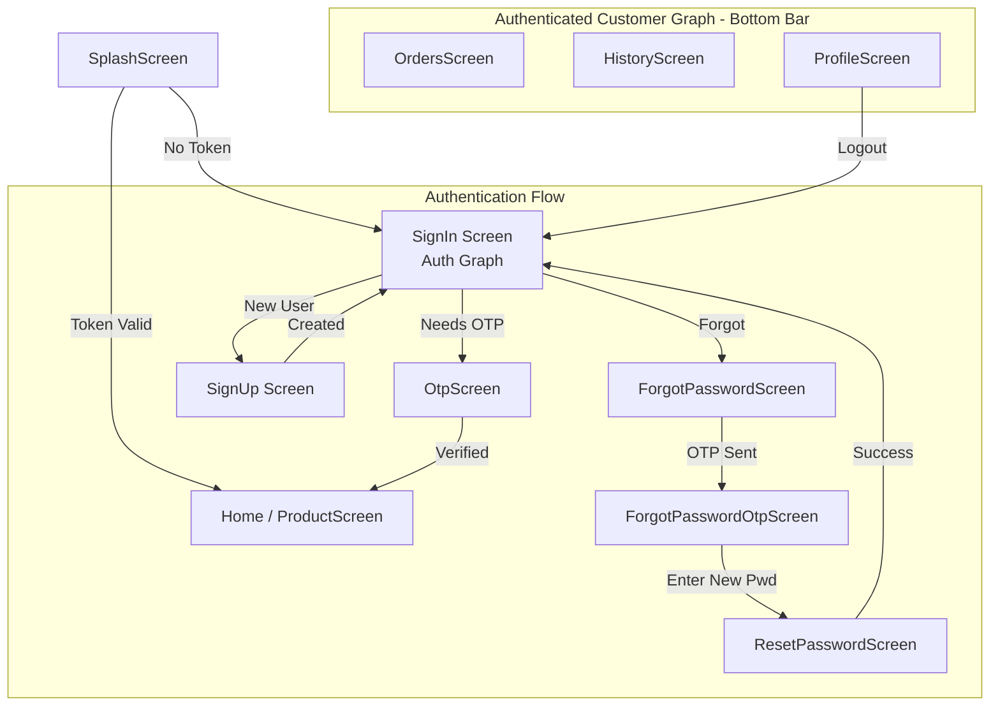
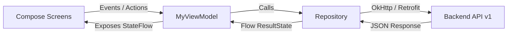

# MediUserApp — Project Architecture & Component Documentation

> **Application Overview**: MediUserApp is a native Android customer-facing pharmacy application built with modern Android development (MAD) practices: Kotlin, Jetpack Compose, Material 3, Clean Architecture / MVVM, Dagger Hilt, and Coroutines/Flow. It connects to the Medi API v1 backend (`/api/v1`) exclusively for users with role `user` (customers).

---

## 1. High-Level Technology Stack

| Layer / Concern | Technology |
|---|---|
| **Language & Tooling** | Kotlin 2.1.21, Java 17, Android Gradle Plugin 8.9+, KSP |
| **Android SDK Support** | Min SDK 31 (Android 12), Target SDK 35 (Android 15), Compile SDK 37 |
| **UI Framework** | Jetpack Compose (Compose BOM), Material 3 Design System |
| **Navigation** | Navigation Compose 2.9.8 with Type-Safe Kotlinx Serialization Routes |
| **Dependency Injection** | Dagger Hilt 2.56 with Hilt ViewModel |
| **Networking & HTTP** | Retrofit 2.11.0, OkHttp 5.4.0 (Logging, Auth, Version, Error Interceptors) |
| **JSON & Serialization** | Google Gson (with ISO-8601 Instant TypeAdapter), Kotlinx Serialization 1.11.0 |
| **Security & Storage** | AndroidX Security Crypto (`EncryptedSharedPreferences`) |
| **Async & State** | Kotlin Coroutines, StateFlow, SharedFlow |
| **Media & Imaging** | Coil Compose 2.7.0 (Image loading), uCrop 2.2.8 (Image cropping) |
| **Visuals & Charts** | MPAndroidChart v3.1.0, Material Icons Extended 1.7.8 |

---

## 2. Directory & Package Structure

```
MediUserApp/
├── app/
│   ├── build.gradle.kts                # App-level build configuration & dependencies
│   ├── proguard-rules.pro              # Proguard configuration
│   └── src/
│       ├── main/
│       │   ├── AndroidManifest.xml     # Permissions, Application class, MainActivity
│       │   ├── java/com/saurabh/mediuserapp/
│       │   │   ├── MainActivity.kt     # Single Activity entry point with Edge-to-Edge
│       │   │   ├── MyApplication.kt    # @HiltAndroidApp Application class
│       │   │   │
│       │   │   ├── common/             # Common domain helpers
│       │   │   │   └── ResultState.kt  # Sealed interface: Loading, Success<T>, Error
│       │   │   │
│       │   │   ├── data/v1/            # API v1 Client & Domain Models
│       │   │   │   ├── api/            # Retrofit Service Interfaces
│       │   │   │   │   ├── AuthApi.kt      # Login, verify-otp, refresh, password-reset, logout
│       │   │   │   │   ├── DevicesApi.kt   # Register / unregister push notification tokens
│       │   │   │   │   ├── HealthApi.kt    # Health check & ready probe endpoints
│       │   │   │   │   ├── MetaApi.kt      # App configuration & version checks
│       │   │   │   │   ├── OrdersApi.kt    # Create, view, cancel orders, upload prescription, invoices
│       │   │   │   │   ├── ProductsApi.kt  # List products, get by ID/barcode, categories
│       │   │   │   │   └── UsersApi.kt     # Signup, getMe, updateMe
│       │   │   │   │
│       │   │   │   ├── core/           # Core API wrappers & serializers
│       │   │   │   │   ├── ApiEnvelope.kt            # Generic JSON response wrapper
│       │   │   │   │   ├── ApiResult.kt              # Safe API result wrapper
│       │   │   │   │   ├── AppEvents.kt              # Broadcast events (Session expired, blocked, upgrade)
│       │   │   │   │   ├── IdempotencyKeyProvider.kt # UUID provider for mutation endpoints
│       │   │   │   │   ├── OrderStatus.kt            # Order lifecycle enum (PENDING, APPROVED, SOLD, etc.)
│       │   │   │   │   ├── PageRequest.kt            # Standard pagination & filter parameters
│       │   │   │   │   ├── UiState.kt                # Generic sealed UI state wrapper
│       │   │   │   │   └── V1Gson.kt                 # Configured Gson instance with Instant adapter
│       │   │   │   │
│       │   │   │   ├── di/             # Dagger Hilt dependency modules
│       │   │   │   │   └── V1ApiModule.kt # Binds v1 API services to @V1Retrofit
│       │   │   │   │
│       │   │   │   ├── dto/            # Data Transfer Objects (Request / Response)
│       │   │   │   │   ├── AuthDtos.kt    # Login, TokenData, PasswordReset DTOs
│       │   │   │   │   ├── DeviceDtos.kt  # Device register / unregister DTOs
│       │   │   │   │   ├── InvoiceDtos.kt # Order invoice metadata & totals
│       │   │   │   │   ├── MetaDtos.kt    # AppConfig, version rules, maintenance info
│       │   │   │   │   ├── OrderDtos.kt   # Order, OrderItem, Prescription DTOs
│       │   │   │   │   ├── ProductDtos.kt # Product, ProductCategory, Brand DTOs
│       │   │   │   │   └── UserDtos.kt    # User profile, address, contact DTOs
│       │   │   │   │
│       │   │   │   └── error/          # Error handling & parsing
│       │   │   │       ├── AppError.kt    # Typed application error representation
│       │   │   │       ├── ErrorBody.kt   # Raw backend error response envelope
│       │   │   │       └── ErrorCode.kt   # Error enum (UNAUTHORIZED, RATE_LIMITED, etc.)
│       │   │   │
│       │   │   ├── network/            # Networking & OkHttp infrastructure
│       │   │   │   ├── ApiProvider.kt            # Retrofit & OkHttp Hilt provider module
│       │   │   │   ├── ApiServices.kt            # Legacy Retrofit interface (kept for migration fallback)
│       │   │   │   ├── AuthInterceptor.kt        # Injects Bearer token into authenticated requests
│       │   │   │   ├── ErrorEventInterceptor.kt   # Emits global app events on HTTP 401, 403, 426, 429
│       │   │   │   ├── LoggingInterceptor.kt     # Custom formatted request/response logging
│       │   │   │   ├── TokenAuthenticator.kt     # OkHttp Authenticator for automatic 401 token refresh
│       │   │   │   ├── TokenManager.kt           # EncryptedSharedPreferences token & session store
│       │   │   │   ├── V1Paths.kt                # Endpoint paths constants
│       │   │   │   ├── VersionInterceptor.kt      # Injects Client-Version and Platform headers
│       │   │   │   └── response/                 # Legacy response DTOs
│       │   │   │
│       │   │   ├── repo/               # Repository Data Layer
│       │   │   │   ├── Repository.kt        # Unified single repository for all API calls
│       │   │   │   └── RepositorySupport.kt # Coroutine flow builders & safe API call executors
│       │   │   │
│       │   │   ├── ui/                 # Presentation & UI Layer
│       │   │   │   ├── components/     # Reusable Compose widgets
│       │   │   │   │   ├── AuthComponents.kt  # Auth header, fields, buttons, loading overlays
│       │   │   │   │   └── SpecificUser.kt    # User details key-value attribute list
│       │   │   │   ├── nav/            # App Navigation
│       │   │   │   │   ├── NavApp.kt          # Root NavHost, bottom navigation bar, back stack rules
│       │   │   │   │   └── Routes.kt          # Type-safe Serializable navigation routes
│       │   │   │   ├── screens/        # Screen composables
│       │   │   │   │   ├── ForgotPasswordOtpScreen.kt # OTP screen for password reset
│       │   │   │   │   ├── ForgotPasswordScreen.kt    # Email input for password reset request
│       │   │   │   │   ├── HistoryScreen.kt           # Sales / purchase history list
│       │   │   │   │   ├── OrdersScreen.kt            # Placed orders & status tracking
│       │   │   │   │   ├── OtpScreen.kt               # Login OTP verification screen
│       │   │   │   │   ├── ProductScreen.kt           # Product list, category filters, product cards
│       │   │   │   │   ├── ProfileScreen.kt           # User profile info, account actions, logout
│       │   │   │   │   ├── ResetPasswordScreen.kt     # New password input screen
│       │   │   │   │   ├── SignIn.kt                  # Email + Password login screen
│       │   │   │   │   ├── SignUp.kt                  # Account registration screen
│       │   │   │   │   ├── SplashScreen.kt            # Animated splash & auth routing
│       │   │   │   │   └── WaitingScreen.kt           # Account verification pending screen
│       │   │   │   └── theme/          # Compose theme setup
│       │   │   │       ├── Color.kt               # Theme palette & semantic color tokens
│       │   │   │       ├── Theme.kt               # Material 3 dynamic / static theme definitions
│       │   │   │       └── Type.kt                # Typography configurations
│       │   │   │
│       │   │   ├── utils/              # Utilities & State holders
│       │   │   │   ├── AppLogger.kt             # Structured, tag-based application logging
│       │   │   │   ├── const.kt                 # System & environment constants
│       │   │   │   ├── LoggingExtensions.kt     # Functional extensions for logging
│       │   │   │   ├── UriExtensions.kt         # Content URI to MultipartBody converter
│       │   │   │   ├── User.kt                  # Domain user models
│       │   │   │   └── screensState/            # State dataclasses for all ViewModel flows
│       │   │   │       ├── ActionStates.kt          # Generic action states (UpdateProfile, CancelOrder, etc.)
│       │   │   │       ├── AllProductState.kt       # Product catalog state with pagination
│       │   │   │       ├── CreateOrderState.kt      # Order placement state
│       │   │   │       ├── CreateUserState.kt       # Sign-up registration state
│       │   │   │       ├── GetOrderByIdState.kt     # Specific order detail state
│       │   │   │       ├── GetSpecificProductState.kt # Single product detail state
│       │   │   │       ├── GetUserSellHistoryState.kt # Customer sell history state
│       │   │   │       ├── GetUsersOrdersState.kt   # Order list state with pagination
│       │   │   │       ├── LoginUserState.kt        # User credentials sign-in state
│       │   │   │       ├── PasswordResetOtpState.kt # Reset password confirmation state
│       │   │   │       ├── PasswordResetState.kt    # Reset password request state
│       │   │   │       └── VerifyOtpState.kt        # OTP verification state
│       │   │   │
│       │   │   └── viewModel/
│       │   │       └── MyViewModel.kt  # Centralized Hilt ViewModel exposing StateFlows & intents
│       │   │
│       │   └── res/                    # Resources (drawables, layouts, strings, xml security config)
│       └── test/                       # Unit tests (MockWebServer, DTO parsing, TokenAuthenticator, Repo)
├── build.gradle.kts                    # Root project build configuration
├── settings.gradle.kts                 # Repositories & project include settings
└── secrets.properties                  # Physical/Virtual device base URLs
```

---

## 3. Navigation System & Screen Catalog

Navigation is configured in `NavApp.kt` using Navigation Compose with Kotlinx Serialization type-safe routes (`Routes.kt`).



### 3.1. Route Definitions (`Routes.kt`)

| Route Name | Arguments | Description |
|---|---|---|
| `Routes.SplashRoutes` | None | Initial launch screen. Checks token existence and routes to main or auth graph. |
| `Routes.SignInRoutes` | None | Email & Password sign-in screen. |
| `Routes.SignUpRoutes` | None | New customer registration form. |
| `Routes.VerifyOtpRoutes` | `userId: String?` | 2-factor OTP verification screen during login. |
| `Routes.ForgotPasswordRoutes` | None | Step 1 of password recovery: submit email to trigger OTP. |
| `Routes.ForgotPasswordOtpRoutes` | `userId: String` | Step 2 of password recovery: enter 6-digit OTP sent to email. |
| `Routes.ResetPasswordRoutes` | `userId: String` | Step 3 of password recovery: enter new password + confirm OTP. |
| `Routes.ProductRoutes` | None | Main product catalog & home screen (Bottom Bar item 0). |
| `Routes.OrdersRoutes` | None | Customer order history & tracking (Bottom Bar item 1). |
| `Routes.HistoryRoutes` | None | Customer purchase / sell history (Bottom Bar item 2). |
| `Routes.ProfileRoutes` | None | Customer account info, settings & logout (Bottom Bar item 3). |
| `Routes.SpecificProductRoutes` | `productId: String` | Deep-link / detail route for individual product inspection. |
| `Routes.EachUserOrderRoutes` | `userId: String` | Detail route for a single order and invoice lookup. |
| `Routes.WaitingRoutes` | `userId: String?` | Pending approval holding screen for accounts awaiting approval. |

---

### 3.2. Detailed Screen Specifications

#### 1. `SplashScreen` (`SplashScreen.kt`)
* **Purpose**: Entry gateway that evaluates authentication credentials before rendering the app.
* **Behaviors**:
  * Displays an animated medical shield icon with pulse scale animation and branded gradient typography.
  * Checks `viewModel.isUserLoggedIn.value`.
  * If authenticated: navigates to `Routes.ProductRoutes` with `popUpTo(Routes.SplashRoutes) { inclusive = true }`.
  * If unauthenticated: navigates to `Routes.SignInRoutes` with `popUpTo(Routes.SplashRoutes) { inclusive = true }`.

#### 2. `SignIn` (`SignIn.kt`)
* **Purpose**: Authentication screen for existing customers.
* **Features**:
  * Animated shifting multi-color gradient background.
  * Inputs: Email (with auto-focus) and Password (with visibility toggle).
  * Validation: Empty fields, format validation.
  * State Integration: Observes `viewModel.loginUserState`.
  * Loading state: Fullscreen `LoadingOverlay`.
  * On Success: Navigates to `Routes.VerifyOtpRoutes` passing `accountId`.
  * Links: Quick jump to `SignUpRoutes` and `ForgotPasswordRoutes`.

#### 3. `SignUp` (`SignUp.kt`)
* **Purpose**: Customer registration form.
* **Features**:
  * Styled glassy inputs (`GlossyTextField`, `GlossyPasswordField`).
  * Fields: Full Name, Email, Phone Number, Password, Confirm Password, Address, Pincode.
  * Client-side validation: Password match confirmation, phone number length, pincode format.
  * State Integration: Observes `viewModel.createUserState`.
  * On Success: Displays success notification and directs user to `SignInRoutes`.

#### 4. `OtpScreen` (`OtpScreen.kt`)
* **Purpose**: Two-factor OTP verification completing customer login.
* **Features**:
  * 6-digit OTP input field.
  * 60-second countdown timer with resend button unlock.
  * Observes `viewModel.verifyOtpState`.
  * On Success: Saves JWT tokens to `TokenManager`, navigates to `ProductRoutes`, and clears entire auth backstack with `popUpTo(0) { inclusive = true }`.

#### 5. `ForgotPasswordScreen` (`ForgotPasswordScreen.kt`)
* **Purpose**: Password recovery initialization.
* **Features**:
  * Clean Material 3 card layout with `AuthHeader`.
  * Email input with instant format check.
  * Triggers `viewModel.requestPasswordReset(email)`.
  * Navigates to `ForgotPasswordOtpRoutes(userId = email)`.

#### 6. `ForgotPasswordOtpScreen` (`ForgotPasswordOtpScreen.kt`)
* **Purpose**: Validates recovery OTP received via email.
* **Features**:
  * OTP input with automatic timer and resend option.
  * Navigates to `ResetPasswordRoutes`.

#### 7. `ResetPasswordScreen` (`ResetPasswordScreen.kt`)
* **Purpose**: Final step to enter new password.
* **Features**:
  * Password & Confirm Password input with visibility toggles.
  * Submits `viewModel.resetPasswordOtp(email, otp, newPassword)`.
  * On Success: Clears recovery stack and returns to `SignInRoutes`.

#### 8. `ProductScreen` (`ProductScreen.kt`)
* **Purpose**: Main customer home screen displaying medicine & pharmaceutical inventory.
* **Features**:
  * **Top Metrics**: `StatsCard` summarizing available medicines, low-stock alerts, and categories.
  * **Category Filter**: `LazyRow` filter chips for dynamic filtering.
  * **Search Bar**: Real-time filtering by medicine name, salt, or manufacturer.
  * **Product List**: Scrollable `LazyColumn` of `EachProductCard`.
  * **Floating Action Button**: Quick interaction hook.
  * **State Integration**: Observes `viewModel.getAllProduct` with pull-to-refresh & pagination support (`loadMoreProducts`).

#### 9. `OrdersScreen` (`OrdersScreen.kt`)
* **Purpose**: Placed orders tracking screen.
* **Features**:
  * Displays user order list with order ID, date, status, and price.
  * Back navigation integration.
  * Direct hook for `viewModel.userOrdersState` and pagination (`loadMoreOrders`).

#### 10. `HistoryScreen` (`HistoryScreen.kt`)
* **Purpose**: Customer purchase and transaction history screen.
* **Features**:
  * Displays completed purchases, dates, and order totals.
  * Hook for `viewModel.sellHistoryState`.

#### 11. `ProfileScreen` (`ProfileScreen.kt`)
* **Purpose**: User details, contact info, and account session management.
* **Features**:
  * Top App Bar with centered title and red logout icon button.
  * Customer avatar with initials badge and username.
  * Info Card: Email, Phone, Address, Pincode using `ProfileInfoRow`.
  * Logout Dialog: Confirmation dialog triggering `viewModel.logout()`.
  * Backstack Protection: When `isUserLoggedIn == false`, navigates to `SignInRoutes` and clears entire stack (`popUpTo(0)`).

#### 12. `WaitingScreen` (`WaitingScreen.kt`)
* **Purpose**: Status screen for accounts requiring admin approval before token issuance.
* **Features**:
  * Progress indicator and explanation messaging.
  * Shows account ID and approval guidance.

---

## 4. Reusable UI Components

### 4.1. Authentication Components (`AuthComponents.kt`)

* **`AuthHeader(title: String, subtitle: String, modifier: Modifier)`**
  * Top banner card with rounded bottom corners (`32.dp`) and a gradient fill (`MaterialTheme.colorScheme.primary` → `tertiary`). Displays headline and subtitle in high contrast typography.
* **`AuthTextField(...)`**
  * Material 3 `OutlinedTextField` pre-styled with rounded corners (`14.dp`), leading vector icon, explicit keyboard type, single-line constraint, and dynamic inline error text rendering.
* **`AuthPasswordField(...)`**
  * Password variant of `AuthTextField` with built-in visibility toggle icon (`Visibility` / `VisibilityOff`) and `PasswordVisualTransformation`.
* **`AuthButton(text: String, onClick: () -> Unit, enabled: Boolean, isLoading: Boolean)`**
  * Full-width (`54.dp` height) primary button with horizontal gradient background, rounded corners (`14.dp`), and automatic progress spinner (`CircularProgressIndicator`) when `isLoading = true`.
* **`LoadingOverlay(isVisible: Boolean)`**
  * Modal dialog showing a rounded card with progress spinner and "Please wait..." text to block interaction during async network requests.
* **`AnimatedAuthContent(delayMillis: Int, content: @Composable () -> Unit)`**
  * Staggered entry animation wrapper using `fadeIn` + `slideInVertically` for fluid UI rendering.

### 4.2. Product & Catalog Components (`ProductScreen.kt`)

* **`ProductListScreen(...)`**: The main container for product search, status summary, and inventory listing.
* **`EachProductCard(medicine: ProductDto, navController: NavController, cardBgColor: Color)`**: Elevated product card displaying medicine name, category, dosage form, price, stock status, and favorite toggle.
* **`StatsCard(title: String, value: String, subtitle: String, icon: ImageVector, gradient: Brush)`**: Dashboard metric card highlighting counts (e.g., Total Medicines, Low Stock).
* **`HorizontalScrollable1(content: @Composable () -> Unit)`**: Smooth horizontal scrolling container for category pills.
* **`LoadingScreen()`**: Fullscreen centered indeterminate progress indicator.
* **`ErrorScreen(errorMessage: String)`**: Standardized error display with retry options.

### 4.3. Profile & User Components (`ProfileScreen.kt` & `SpecificUser.kt`)

* **`ProfileInfoRow(icon: ImageVector, label: String, value: String)`**: Reusable row in the profile card displaying an icon, label, and user value.
* **`SpecificUser(user: UserDto)`**: Formatted vertical list rendering user entity attributes (User ID, Name, Phone, Email, Pin Code, Address).

### 4.4. Glossy / Glassmorphic Custom Inputs (`SignUp.kt`)

* **`GlossyTextField(...)`**: Translucent background text field styled for gradient backgrounds with custom border highlights.
* **`GlossyPasswordField(...)`**: Translucent password input with visibility toggle.
* **`SocialButton(iconRes: Int, text: String, onClick: () -> Unit)`**: Secondary outlined button for social/alternate actions.

---

## 5. ViewModel & State Architecture (`MyViewModel.kt`)

`MyViewModel` is the single source of truth for all screens. It communicates exclusively with `Repository.kt` and translates responses into type-safe UI states.



### 5.1. Exposed StateFlows

| StateFlow Property | State Type | Consumed By |
|---|---|---|
| `isUserLoggedIn` | `StateFlow<Boolean>` | `NavApp`, `SplashScreen`, `ProfileScreen` |
| `upgradeRequiredVersion` | `StateFlow<String?>` | Global app gate (blocking update screen) |
| `messages` | `SharedFlow<String>` | Global Snackbar host (rate limits, block warnings) |
| `appConfigState` | `StateFlow<UiState<AppConfig>>` | Maintenance & version checkers |
| `createUserState` | `StateFlow<CreateUserState>` | `SignUp` |
| `loginUserState` | `StateFlow<LoginUserState>` | `SignIn` |
| `verifyOtpState` | `StateFlow<VerifyOtpState>` | `OtpScreen` |
| `passwordResetState` | `StateFlow<PasswordResetState>` | `ForgotPasswordScreen` |
| `passwordResetOtpState` | `StateFlow<PasswordResetOtpState>` | `ResetPasswordScreen` |
| `specificUserState` | `StateFlow<UserState>` | `ProfileScreen`, `WaitingScreen` |
| `updateProfileState` | `StateFlow<UpdateProfileState>` | Profile edit forms |
| `getAllProduct` | `StateFlow<AllProductState>` | `ProductScreen` |
| `specificProductState` | `StateFlow<GetSpecificProductState>` | Product detail views |
| `userOrdersState` | `StateFlow<GetUsersOrdersState>` | `OrdersScreen` |
| `orderDetailState` | `StateFlow<GetOrderByIdState>` | Order detail modal/screen |
| `sellHistoryState` | `StateFlow<GetUserSellHistoryState>` | `HistoryScreen` |
| `createOrderState` | `StateFlow<CreateOrderState>` | Order creation & checkout |
| `cancelOrderState` | `StateFlow<CancelOrderState>` | Order cancellation dialogs |
| `uploadPrescriptionState` | `StateFlow<UploadPrescriptionState>` | Prescription attachment modal |
| `invoiceState` | `StateFlow<UiState<InvoiceDto>>` | Invoice download / preview |

---

## 6. Networking, Security & Authentication Architecture

### 6.1. OkHttp Client Pipeline

All HTTP requests pass through a single unified OkHttp client stack configured in `ApiProvider.kt`:

1. **`VersionInterceptor`**: Injects `Client-Version: 1.0` and `Client-Platform: android` for backward compatibility and backend deprecation detection.
2. **`AuthInterceptor`**: Injects `Authorization: Bearer <token>` from `TokenManager` for all secured v1 endpoints. Skips public routes (login, verify-otp, forgot-password, signup).
3. **`ErrorEventInterceptor`**: Intercepts HTTP error responses globally and emits events to `AppEvents`:
   * `401 Unauthorized`: Emits session expired event.
   * `403 Forbidden`: Emits account blocked event if code is `ACCOUNT_BLOCKED`.
   * `426 Upgrade Required`: Emits upgrade required event.
   * `429 Too Many Requests`: Emits rate limit warning.
4. **`TokenAuthenticator`**: Automatically catches HTTP 401 on authenticated endpoints, enters a thread-safe `refreshLock`, uses the stored refresh token to obtain a fresh access token from `POST auth/refresh`, updates `TokenManager`, and replays the failed request transparently.
5. **`HttpLoggingInterceptor` / `LoggingInterceptor`**: Logs sanitized request bodies, headers, and timings in debug mode.

### 6.2. Secure Token Storage (`TokenManager.kt`)

* Uses AndroidX `EncryptedSharedPreferences` backed by Android KeyStore (`MasterKey`).
* Automatically migrated from legacy unencrypted `auth_prefs` to `auth_prefs_secure`.
* Stores: `access_token`, `refresh_token`, `user_role`, `account_id`, `account_type`, `expires_at`.
* Strictly validates customer role (`user`).

---

## 7. Status & Pending Roadmap

| Feature / Screen | Status | Notes |
|---|---|---|
| **Splash & Navigation** | ✅ Complete | Fixed start destination, backstack cleanup on login/logout |
| **SignIn & Login OTP** | ✅ Complete | Email + password, 2FA OTP verification, token persistence |
| **SignUp** | ✅ Complete | Registration form with validation |
| **Password Reset** | ✅ Complete | Request OTP -> Verify OTP -> Set New Password flow |
| **Product Screen** | ✅ Complete | Inventory listing, category filtering, search, pagination |
| **Profile Screen** | ✅ Complete | User summary, logout confirmation with full stack clear |
| **Orders Screen** | ⚠️ UI Skeleton | Screen created; pending data binding to `viewModel.userOrdersState` |
| **History Screen** | ⚠️ UI Skeleton | Screen created; pending data binding to `viewModel.sellHistoryState` |
| **Prescription Upload** | ⚠️ ViewModel Ready | `uploadPrescription(...)` ready; needs file picker UI |
| **Order Placement UI** | ⚠️ ViewModel Ready | `createOrder(...)` ready; needs cart & checkout dialogs |
| **Invoice Viewer** | ⚠️ ViewModel Ready | `getInvoice(...)` ready; needs display screen |
